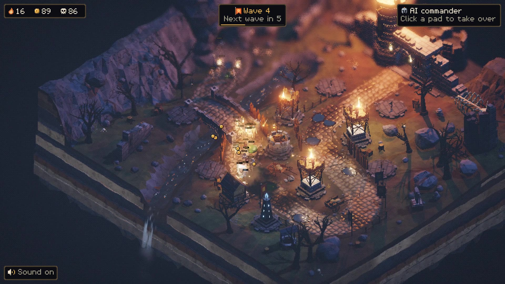
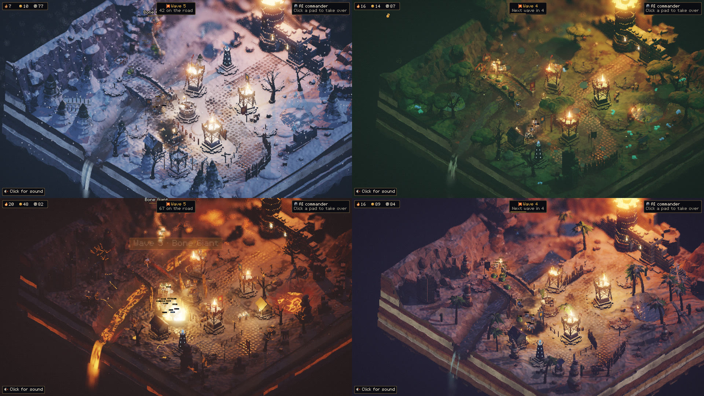
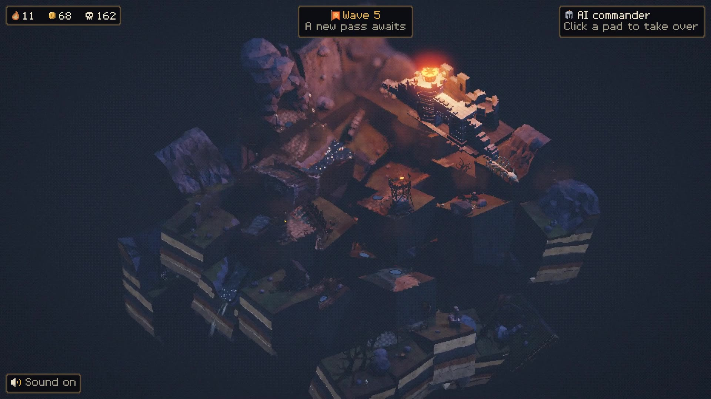

# Cinderwatch

A self-playing 3D isometric tower defense in a single HTML file.

A handful of firelit towers hold the great beacon of a ruined keep against endless columns of monsters, across five lands from a dark mountain pass to a snowfield, a bog, a lava scar and a desert at dusk. Pick a land on the Start Menu and defend it yourself for as long as you can, or watch the AI commander play a demo through every land.

> **This is a fork** of [Cinderwatch by Kevin Ngo](https://github.com/kevintngo/cinderwatch) (MIT). It adds a Bloons-style layer on top of the original: freeform tower placement, branching upgrade paths, three new towers, tier-3 abilities, Paragons, Endless waves, save/resume, a crisp cinematic renderer, and a Start Menu with land selection, permanent player runs and a Second Chance. Play this fork at [kevo589.github.io/cinderwatch](https://kevo589.github.io/cinderwatch/), or open `index.html` in a browser. The original game is playable at [kevintngo.github.io/cinderwatch](https://kevintngo.github.io/cinderwatch/).

[Watch 20 seconds of gameplay](media/gameplay-20s.mp4) (the clip and screenshots show the original game, before this fork's additions).



## What is in it

### Towers, built anywhere

There are no fixed pads. Pick a tower from the build bar and place it on any open ground: not on the road, in water, on a steep slope, too near the cliffs, the cave or the keep, or on top of scenery. A ring shows its footprint and range, green where it can go and red, with the reason, where it can't. Guard posts and caltrop forges must stand within reach of the road. Every tower stands on its own stone footing and is raised piece by piece inside scaffolding.

Seven towers, each with two upgrade paths of three tiers. One path can reach tier 3 while the other stops at tier 2 (a 3-2 or 2-3 tower at most), and each path changes how the tower looks.

| Tower | Path A | Path B |
| --- | --- | --- |
| **Archer tower** | Volley: more archers, faster shots, bursts of flaming arrows | Sharpshooter: range, armor-piercing bodkins, crits that hit fading wraiths |
| **Bombard** | Siege mortar: bigger blasts, armor shredding, a stunning siege shell | Incendiary: faster reload, burning ground, cluster bomblets |
| **Storm spire** | Arc conduit: more and longer chain jumps, sky-bolt overloads on the strongest foe | Cryo tempest: deeper slow, a frost aura, brittle foes taking +25% damage |
| **Guard post** | Citadel: more, tougher, armored footmen and cleaving knights | Quartermaster: war banners that speed up nearby towers, gold every wave, bonus bounty |
| **Caltrop forge** | Barbed iron: bigger piles, red-hot spikes that melt armor, piles that explode when spent | Enduring vault: faster, wider drops, piles that last a wave more, then gilded piles that last three |
| **Alchemist** | Brewmaster: brews that let nearby towers pierce armor, then fire faster, hit harder and reach further, then never wear off | Plague cauldron: fiercer acid, corrosion that makes everything hit coated monsters harder, monsters that burst for gold |
| **Gold foundry** | Mint works: richer mint bursts during waves and a dividend at the end of each | Guild bank: a vault that earns interest (with a Collect button), and discounts on nearby upgrades |

The foundry has no attack. The alchemist's buffs never land on other alchemists, foundries or Paragons.

### Tier-3 abilities

Every tier-3 path brings an active ability with its own cooldown, which only runs while there is fighting: fourteen in all, from Arrow Storm, Concussion Barrage and Permafrost to Iron Carpet, Blight Storm and Guild Loan. They sit in a bar at the bottom left that appears once you own a tier-3 tower; copies of the same ability share one slot with a ready count, and a dark sweep shows the cooldown. War Chest and Bullion Shipment can be used twice a wave, Guild Loan once. The AI commander uses abilities too, saving the big ones for bosses and crowded roads.

### Paragons

Own a 3-x and an x-3 of the same kind and either one can ascend into a Paragon citadel: the **Sunfire Watchtower**, **Cataclysm Siegeworks**, **Maelstrom Obelisk**, **Grand Bastion**, **Obsidian Mineworks** or **Philosopher's Crucible**. There is one per kind, and the gold foundry cannot ascend.

Ascending absorbs every other tower of that kind; embers stream from them into the new citadel. What they bring (their upgrade tiers, the damage they dealt and the gold they earned), plus any gold you infuse with the slider, sets the Paragon's **Degree**, 1 to 100. Degree raises its damage, fire rate and ability cooldown, with a step up in boss damage at Degrees 20, 40, 60, 80 and 100. A Paragon has both tier-3 paths' powers at once and an ability of its own, carries the damage and kills of everything it absorbed, and sells for 60% of everything that went into it.

### The Start Menu

Opening the page brings up the Start Menu over a live, slowly turning view of the chosen land. Five cards list the lands with their boss and your best wave there. Pick one and the view rebuilds into it.

- **Defend Pass** starts wave 1 on that land with you in command from the first frame.
- **Resume Run (Wave N · land)** appears when there is a saved run.
- **Watch AI Demo** starts the original self-playing tour through every land.

A line at the bottom credits the original Cinderwatch by Kevin Ngo; tap it to open the original repository.

Any URL flag (`#seed=`, `#biome=`, `#manual=1`, `#ff=` and the rest) skips the menu and starts the demo as before, so replays stay deterministic.

### Your run: one land, for good

A run you start stays on its land. There is no march to the next land and no Hold or March choice: waves keep coming (6, 7, 8 and on), with a boss every fifth wave and more bosses at once as the waves climb. Your best wave on each land is remembered.

Pause (`P` or the pause button) opens a menu with Resume, Save Run, Visuals and **Return to Menu**, which saves the run first.

When the beacon goes out, the battlefield stays where it fell and a Defeat screen shows the land, the wave, the monsters slain, a **New best** badge if you beat your record there, and your MVP tower.

- **Second Chance**, from wave 10, once per run: the beacon flares back to life, the road is cleared, you get 10 lives and 150 + 15 × wave gold, and the wave you lost starts again after a six-second countdown. It survives a refresh as used, so reloading never buys a second one.
- **Return to Start Menu** ends the run and deletes its save. Your bests are kept.

### Lands, bosses and Endless

- **Twenty kinds of monster**, each with its own model and trick. Skeletons, giant rats, slimes that split, shield-bearing knights and bats are joined by:
  - ghouls that run faster as they are hurt, dire wolves, and cave spiders and scarabs that slip past the guards
  - sappers whose powder keg blows up friend and foe, and wraiths that arrows and swords pass through while they fade
  - war drummers that speed up everything near them, and necromancers that raise more skeletons
  - bog toads, mummies that burst into scarabs, and brood mothers that burst into spiders
  - trolls that heal, stone golems that shrug off arrows, and gargoyles and glowing wisps in the air
- **A boss on every fifth wave**: the Bone Giant, the Frost Jotun that freezes towers, the Brood Queen, the Magma Colossus and the Buried King, with the Ogre waiting on a second visit to Ashen Pass. Each land also favors its own monsters, and tints some of them to match.
- **Five lands**: Ashen Pass, Frostfall (snow, a frozen stream and falling snow), Mirefen (bog pools, willows, glowing mushrooms and fireflies), Emberscar (a lava river, charred trees and ash) and Duskmesa (dunes, palms and an oasis). A page opened without a seed starts in a random one.
- **Endless waves.** Past wave 5, monsters grow tougher and faster; past wave 15 gold tapers off, and from wave 20 bosses come two at a time, three from wave 30 and four from wave 45, with monsters toughening faster still past wave 25. Your own runs are always Endless on one land.
- **The demo marches on.** In the AI demo, after each boss the slab crumbles away while a new one, with a different road and the next land, assembles out of the dark, so every land gets shown. If you take command during the demo, beating a boss yourself offers **March to next land** or **Hold this pass**.
- **Save and resume.** While you are in command, the run saves itself at the start of every wave, and a Save button in the bottom row saves on demand (mid-wave, it keeps the start of the wave). Resume Run on the Start Menu rebuilds the same battlefield exactly: every tower as you left it, with its paths, Paragon Degree, counters and vault, lasting caltrop piles back on the road, whether the Second Chance is spent, and a short countdown before the next wave.

### The rest

- **Light as the main character.** A flickering beacon, a brazier on every tower, flaming arrows, cannon flashes and chain lightning, with moving shadows. Any number of towers can stand; the twelve tower lights go to the ones nearest the camera and busiest.
- **Three looks, switched with the HD button in the bottom row or `V`, and remembered.** **Crisp cinematic** (the default) draws the scene at your screen's full resolution (up to twice its CSS pixels) with a filmic grade: deep blue-black shadows, warm firelight, bloom only on flames, lightning and glows, a soft vignette and very fine grain; only the far void beyond the slab softens. **Classic miniature** is the original look: drawn at about half resolution with an ordered dither, a depth-aware tilt-shift blur, a stronger vignette and grain. **Performance** draws at one pixel per CSS pixel with depth of field off, for slower laptops and phones. In every look the resolution steps down on its own if the frame rate drops below about 45, and back up when it recovers (`#noscale=1` turns that off).
- **No asset files.** Every model, texture and sound is generated in code.
- **Small comforts.** The first time each monster appears, a line says what it does. Each tower's sheet shows what its next tiers do, plus the damage it has dealt, its kills and any gold it has earned. Every tower can be told to target the first, last, closest or strongest monster. The wave plate shows the gold for calling a wave early. Your best wave overall and on each land, the land picked on the Start Menu, and your mute setting are remembered.





## Controls

On the Start Menu, `1` to `5` or the arrow keys pick a land, `Enter` or `Space` defends it, and the cards and buttons can be clicked or tapped. In a run you are in charge from the start. In the AI demo, your first command puts you in charge, and the AI commander stays out until you hand the battle back.

| Input | Action |
| --- | --- |
| `1` to `7`, or the build bar at the bottom | Pick a tower to place; a ring on the ground shows its footprint and range, green where it can go and red (with the reason) where it can't |
| Click open ground | Build the picked tower there |
| Shift-click | Build and keep the same tower picked |
| Right-click or `Esc` | Stop placing |
| Hover a tower | Highlight it and show its range |
| Click or tap a tower | Open its sheet: two upgrade paths, targeting and sell |
| `Q` / `E` (tower selected) | Buy the next tier on Path A or Path B |
| `U` | Buy the next tier on the tower's leading path |
| `Shift+1` to `Shift+9`, or tap a slot in the ability bar | Use the ability in that slot, counting from the left |
| `T`, or the Target button | Cycle the tower's targeting: First, Last, Close, Strong (not for guard posts) |
| `E` with no tower selected, after a boss you beat yourself in the demo | Hold this pass: stay on this battlefield in Endless mode, with towers, gold and lives kept |
| `N`, or the Next land button (demo only) | After a boss, march to the next land; in Endless, leave for the next land between waves (on touch the button asks for a second tap) |
| `X` | Sell the selected tower (press twice, or click Sell twice, to confirm) |
| `Space` | Call the next wave early |
| `C`, or click the commander plate | Hand command back to the AI, or take it |
| `M` | Mute (remembered for next time) |
| `V`, or the HD / FAST / MINI button | Switch the look: crisp cinematic, performance, classic miniature (remembered) |
| `P` | Pause, with a menu: Resume, Save Run, Visuals and Return to Menu (which saves first); `Esc` closes it |
| The Save button in the bottom row (while you command) | Save the run now; mid-wave it keeps the start of the wave |
| `Tab` | Game speed: 1x, 2x, 3x |
| Mouse wheel or trackpad pinch | Zoom toward the pointer |
| `+` and `-`, or the buttons in the corner | Zoom in and out |
| Drag the ground, arrow keys or `W` `A` `S` `D` | Move the view |
| Double-click the ground | Zoom in there; again to zoom back out |
| `F`, `0`, or the Follow the fight button | Hand the view back to the camera |
| `Esc` | Close the menu, or stop placing |
| `Enter` on the Defeat screen | Take the Second Chance if there is one |
| Gamepad | Stick or D-pad moves between towers and a few good open spots, A opens and confirms, B closes, X upgrades, Y calls the next wave |

Browsers keep audio off until a gesture, so the first click, tap or key press turns the sound on.

### On a phone or tablet

The game plays in portrait and in landscape, and follows the screen when it turns.

| Touch | Action |
| --- | --- |
| Tap a tower in the build bar | Pick it to place |
| Tap the ground | Show the footprint and range there, with Build and Cancel; tap Build (or the same spot again) to build |
| Tap a built tower | Open its sheet above the build bar: buy Path A or Path B tiers, change targeting, or sell (sell asks for a second tap) |
| Tap the wave plate | Call the next wave early |
| Tap the commander plate | Take command; handing it back to the AI takes a second tap. The AI keeps an Endless run going; only you can leave it |
| Drag | Move the view |
| Pinch, or the + and - buttons | Zoom, out to the whole battlefield |
| Double-tap the ground | Zoom in there; again to zoom back out |
| Follow the fight | Hand the view back to the camera |
| The buttons along the bottom | Pause, game speed, the look (HD, FAST or MINI), sound, save (while you command), zoom and, where the browser allows it and there is room, full screen |
| A land card, then Defend Pass, on the Start Menu | Start a run there; Resume Run picks up your saved one |

The layout keeps clear of notches and home indicators, buttons are sized for fingers, the screen is asked to stay awake while the game is open, and sound stops when the page is in the background. It can be installed as an app (Install app or Add to Home screen in the browser menu); installed, it opens full screen with its own icon and, once loaded online, plays offline.

The browser's own double-tap and pinch zoom are turned off on the page, so the view can never get stuck zoomed in; zooming is done by the game, and every way in has a way back out.

Touch was tested with Chrome's phone emulation, not on real phones. Gamepad input has not been tested on real hardware.

## Run it

Open `index.html`. It works from `file://` with no server, no build step and no network.

## Build it

```bash
python3 tools/build.py
```

This joins `src/*.js` into `index.html` and inlines three.js from `vendor/`.

## Layout

| Path | Contents |
| --- | --- |
| `index.html` | The built game |
| `src/00-util.js` | Math, random numbers, noise |
| `src/10-gfx.js` | Procedural textures, the lit material, the geometry builder |
| `src/20-post.js` | Renderer and post-processing |
| `src/29-biome.js` | The five lands: palettes, light, weather and water settings |
| `src/30-layout.js`, `31-terrain.js`, `32-props.js`, `33-flora.js` | Road and stream layout, terrain, scenery, plants and props of each land |
| `src/40-fx.js`, `41-weather.js` | Lights, particles, lightning, decals, snow, ash, dust and fireflies |
| `src/50-rig.js`, `51-bestiary.js` | Characters built from instanced parts, debris, the models of the later monsters |
| `src/60-towers.js`, `61-monsters.js`, `62-game.js` | Towers and their upgrade paths, monsters and the crowd, waves, Endless and the AI commander |
| `src/63-build.js` | Freeform placement rules and the AI's map of good build spots |
| `src/64-abilities.js` | Tier-3 active abilities |
| `src/65-newtowers.js` | Caltrop forge, Alchemist and Gold foundry |
| `src/66-paragon.js` | Paragons: ascension, Degree and their abilities |
| `src/67-save.js` | Saving and resuming runs |
| `src/70-pixelfont.js`, `72-ui.js` | Pixel font, HUD, menus, input |
| `src/80-audio.js` | Synthesized sound |
| `src/90-main.js` | Camera and main loop |
| `tools/` | Build script and test tools |

## Development tools

Both tools drive headless Chrome and need Node 22 or newer. Set `CHROME` if Chrome is not in the default macOS location, and `FFMPEG` if `ffmpeg` is not on your path.

```bash
node tools/cdp.js "seed=4&ff=30" wait:2000 shot:battle eval:"__cw.G.lives"
```

`cdp.js` runs the game in real time and accepts `wait`, `shot`, `eval`, `click`, `move` and `key` steps. Screenshots go to `tools/shots/`. With `MOBILE=1` (and `DPR=3` for a phone's pixel density) it emulates a touch screen of the given size and also accepts `tap`, `drag`, `pinch`, `rotate` and `safe` steps:

```bash
MOBILE=1 DPR=3 node tools/cdp.js "seed=4" 390,844 wait:2000 tap:195,500 shot:phone rotate:844,390 shot:phone-wide
```

```bash
node tools/record.js scan 4 200
node tools/record.js capture 4 5130-5490,9870-10230 out.mp4
```

`record.js` steps the game at a fixed 1/60 s, so a seed always replays the same way. `scan` logs what happens when, `stills` saves frames, and `capture` writes a video of the given frame ranges with the game's own audio.

URL flags, for example `index.html#seed=4&fps=1`:

| Flag | Effect |
| --- | --- |
| `seed=N` | Fix the battlefield and the run (starts in Ashen Pass) |
| `biome=NAME` | Start in `ashen`, `frost`, `fen`, `ember` or `dunes` |
| `level=N`, `k=N` | Start at a later battlefield or wave |
| `ff=S` | Fast-forward S seconds before the first frame |
| `fps=1` | Show frame rate and draw calls |
| `nodof=1` | Turn off depth of field (the tilt-shift blur in Classic miniature) |
| `visuals=NAME` | Start in `cinematic`, `performance` or `miniature` for this load |
| `noscale=1` | Turn off automatic resolution scaling |
| `noopt=1` | Refresh every shadow map every frame and blur every pixel, for comparing speed |
| `manual=1` | Do not start the loop (used by `record.js`) |

Any of `seed`, `manual`, `ff`, `k`, `level`, `biome`, `board`, `phase` or `cam` also skips the resume-a-saved-run panel, so seeded replays are never interrupted.

## License

[MIT](LICENSE). The original Cinderwatch is by Kevin Ngo ([kevintngo/cinderwatch](https://github.com/kevintngo/cinderwatch)); its copyright notice is kept in `LICENSE`, and this fork's additions are released under the same license. The build includes [three.js](https://threejs.org) r170, also MIT ([notice](vendor/LICENSE-three.txt)).
